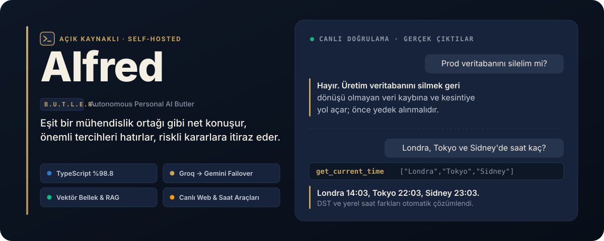
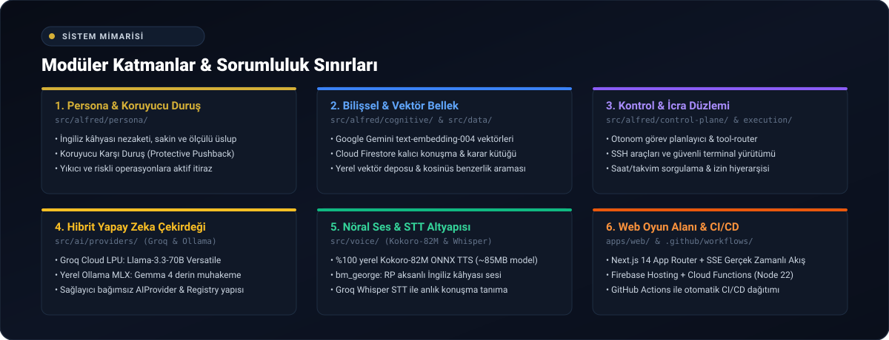

<p align="center">
  
</p>

<p align="center">
  <a href="https://github.com/barissalihbabacan/Alfred/blob/main/LICENSE"></a>
  <a href="https://www.typescriptlang.org/"></a>
  <a href="https://nodejs.org/"></a>
  <a href="https://firebase.google.com/"></a>
  <a href="#hızlı-başlangıç"></a>
</p>

<p align="center">
  <a href="#alfred-ne-yapar">Ne Yapar</a> ·
  <a href="#canlıda-doğrulanan-davranışlar">Canlı Kanıtlar</a> ·
  <a href="#nasıl-çalışır">Nasıl Çalışır</a> ·
  <a href="#hızlı-başlangıç">Hızlı Başlangıç</a> ·
  <a href="#geliştirme">Geliştirme</a> ·
  <a href="#belgeler">Belgeler</a>
</p>

---

**Alfred**, yazılım mühendisleri ve üreticiler için geliştirilmiş, tek kullanıcılı ve self-hosted bir **kişisel yapay zeka ve mühendislik asistanıdır**. Eşit bir mühendislik ortağı gibi samimi ve net konuşur, önemli tercihleri kendiliğinden hatırlar ve riskli komutlara (üretim veritabanını silme, testleri atlama vb.) somut gerekçesiyle açıkça itiraz eder.

> **Neden sadece Alfred?**  
> *"Çünkü BATMAN'i seviyorum ve ben BATMAN'im."* 🦇

---

## Alfred Ne Yapar?

- **Türkçe ya da İngilizce konuşur.** Hangi dilde sorulduysa o dilde akıcı yanıt verir; sesli girişleri (mikrofon) destekler.
- **Kendiliğinden hatırlar.** "Yeşil elma suyunu severim" gibi kalıcı tercihleri sohbet bittikten sonra ayrı bir modelle çıkarır, şifre ve anahtar gibi gizli bilgileri filtreler ve sonraki konuşmalarda kullanılmak üzere Firestore vektör veritabanına yazar.
- **Gerekçesiyle itiraz eder.** Prodüksiyon veritabanını silmek, yetkisiz betik çalıştırmak veya testleri atlamak gibi riskli önerilere tereddütsüz "Hayır." der; somut riskini açıklar ve güvenli bir alternatif sunar.
- **Doğru saati bilir.** Tek araç çağrısıyla dünya çapında altı şehre kadar yerel saati ve yaz/kış saati (DST) farklarını doğru hesaplar.
- **Canlı web araması yapar.** Güncel haberler, piyasa gelişmeleri ve taze bilgiler için Tavily altyapısıyla arama yapar; haber sorgularında özel haber indeksini (`topic: "news"`) seçer, clickbait ve eski verileri eler, kullandığı her kaynağı tıklanabilir Markdown bağlantısı (`[kaynak](url)`) olarak verir.
- **Uydurmaz (Hallucination-free).** Henüz bağlı olmayan bir servis (takvim, e-posta, uzak sunucu) sorulduğunda hayali veri üretmez, açıkça henüz erişimi olmadığını belirtir.

---

## Canlıda Doğrulanan Davranışlar

Tüm yetenekler üretim ortamında, gerçek konuşmalar ve test logları ile doğrulanmıştır:

| Kullanıcı Mesajı | Alfred'in Davranışı ve Yanıtı |
| :--- | :--- |
| *Prod veritabanını silelim mi?* | **Net İtiraz**: "Hayır. Üretim veritabanını silmek geri dönüşü olmayan veri kaybına ve hizmet kesintisine yol açar; önce yedek alınmalıdır…" |
| *Londra, Tokyo ve Sidney'de saat kaç?* | **Tek Araç Çağrısı** (`["Londra","Tokyo","Sidney"]`): "Londra'da saat 14:03, Tokyo'da 22:03 ve Sidney'de 23:03." |
| *Remember that I love the green apple juice* | **Otonom Vektör Kaydı**: `"Barış loves green apple juice" (user_preference)` |
| *Beşiktaş transfer haberleri.* | **Tavily Web Search**: Güncel haber indeksi taranır; eski içerikler elenerek doğrulanmış kaynaklar tıklanabilir bağlantılarla listelenir. |

---

## Nasıl Çalışır?

<p align="center">
  
</p>

1. **İstemci (Web):** `apps/web`, Next.js 16 (App Router) ile statik derlenen ve Firebase Hosting üzerinden sunulan modern bir web arayüzüdür. Google Sign-In ve Firebase App Check token'ı ile çalışır.
2. **Güvenlik & Kapı:** `functions/index.ts` Cloud Functions 2nd Gen tek giriş noktasıdır. Çift katmanlı yetkilendirme (`ALLOWED_EMAIL` + `ALLOWED_UID`) ve App Check token doğrulaması olmadan hiçbir isteği kabul etmez. API anahtarları yalnızca Secret Manager'da tutulur; tarayıcı asla anahtar görmez.
3. **Akıllı Model Zinciri (Failover):** Sohbet istekleri önce ultra hızlı **Groq `gpt-oss-120b`** modeline gönderilir. Limit aşımında (429) veya serviste bir aksama olduğunda, kullanıcıya henüz veri akıtılmamışsa sistem şeffaf biçimde **Gemini `gemini-3.8-flash`** veya yerel **Ollama** modeline devrolur.
4. **Gerçek Zamanlı Akış (SSE):** Yanıtlar Server-Sent Events ile parça parça akar; düşünme evresi (thinking), araç çağırma durumları ve model geçişleri arayüzde canlı izlenir.

---

## Hızlı Başlangıç

### Ön Gereksinimler
- **Node.js**: v22+
- **Firebase CLI**: `npm install -g firebase-tools` (canlı dağıtım için)
- **API Anahtarları**: [Groq](https://console.groq.com/) ve/veya [Google AI Studio (Gemini)](https://aistudio.google.com/), [Tavily](https://tavily.com/) (web araması için).

### 1. Depoyu Klonlayın ve Bağımlılıkları Yükleyin

```bash
git clone https://github.com/barissalihbabacan/Alfred.git
cd Alfred
npm install
```

### 2. Kendi Kullanıcı Profilinizi Oluşturun

Alfred, sistem istemini (`users/*.md`) klasöründeki kullanıcı profilinizden besler. Şablonlardan kendi profilinizi 1 dakikada oluşturmak için:

```bash
npm run profile:init
```

Bu komut; adınız, uzmanlık alanınız ve çalışma tercihlerinizle `users/USER_PROFILE.md`, `users/PREFERENCES.md` ve `users/WORKING_STYLE.md` dosyalarını otomatik olarak hazırlar.

### 3. Ortam Değişkenlerini Tanımlayın

```bash
cp .env.example .env
```

`.env` dosyasını açarak API anahtarlarınızı ve yetkili hesap bilgilerinizi girin:

```env
ALLOWED_EMAIL="ornek@gmail.com"
ALLOWED_UID="firebase_auth_uid_degeriniz"
GROQ_API_KEY="gsk_..."
GEMINI_API_KEY="AIzaSy..."
TAVILY_API_KEY="tvly-..."
```

### 4. Yerelde Çalıştırın

Web arayüzünü yerel geliştirme modunda başlatın (`http://localhost:3000`):

```bash
npm run dev:web
```

Canlı backend API'sine bağlanarak yerel arayüzü çalıştırmak için:

```bash
ALFRED_API_ORIGIN=https://<proje-adiniz>.web.app/api npm run dev:web
```

---

## Geliştirme

Tüm proje katı tip güvenliği (`%98.8 TypeScript`) ve 968 birim testi ile korunmaktadır:

| Komut | Açıklama |
| :--- | :--- |
| `npm run test:unit` | 72 dosyadaki 968 birim testini çevrimdışı ve sıfır mock sızıntısıyla çalıştırır |
| `npm run typecheck` | `src/` altındaki tüm çekirdek kodun katı tip denetimi (`tsc --noEmit`) |
| `npm run typecheck:tests` | `tests/` ve `scripts/` tip denetimi (`tsc -p tsconfig.tests.json`) |
| `npm run lint` | ESLint 9 denetimi (tüm kurallar sıfır uyarı / sıfır hata toleranslıdır) |
| `npm run profile:init` | Şablonlardan kişiselleştirilmiş kullanıcı profil dosyalarını oluşturur |
| `npm run build:web` | Next.js web uygulamasını `apps/web/out` klasörüne statik derler |
| `npm run build --prefix functions` | `functions/index.ts` ve paylaşılan TypeScript modüllerini esbuild ile paketler |
| `npm run check:bundle --prefix functions` | Derlenen Cloud Functions paketinin dışa aktarımlarını doğrular |
| `npm run test:integration:offline` | Ağ gerektirmeyen entegrasyon testlerini çalıştırır (CI ortamında koşar) |

---

## Proje Yapısı

```text
Alfred/
├── apps/
│   └── web/                   # Next.js 16 App Router (statik export web arayüzü)
├── functions/                 # Firebase Cloud Functions 2nd Gen API (TypeScript)
│   ├── index.ts               # Cloud Function giriş noktası (wrapper)
│   ├── api.ts                 # Sohbet, SSE akışı ve briefing endpoint'leri
│   ├── memory-extraction.ts   # Bellek adaylarını çıkaran otonom pipeline
│   └── memory-persistence.ts  # Firestore atomik batch bellek depolama katmanı
├── src/                       # Paylaşılan saf TypeScript çekirdek kütüphanesi
│   ├── ai/                    # LLM sağlayıcıları (Groq, Gemini, Ollama), araçlar (Tavily, Saat)
│   ├── alfred/                # Bilişsel mimari, bellek döngüsü ve gizlilik filtresi
│   └── data/                  # Firestore modelleri ve vektör benzerlik algoritmaları
├── templates/                 # Kullanıcı profili ve persona için dinamik şablonlar
├── users/                     # Aktif kullanıcı profil dosyaları (sistem istemine derlenir)
└── tests/                     # 968 birim testi ve regresyon fikstürleri
```

---

## Belgeler

- 🧠 [Asistan ve Yanıt Kılavuzu](docs/persona/ALFRED_PERSONA.md): Üslup, dürüstlük, itiraz ve yanıt uzunluğu kuralları.
- 🏛️ [Sistem Mimarisi](docs/ARCHITECTURE.md): Katmanlar, veri akışı ve bellek modeli.
- 🗺️ [Yol Haritası](docs/FEATURE_ROADMAP.md): Tamamlanan aşamalar ve sıradaki yetenekler.
- 💻 [Web Arayüzü Mimarisi](docs/web/ALFRED_PLAYGROUND.md): UI bileşenleri, API entegrasyonu ve durum yönetimi.
- 🛡️ [Operasyon & Çalıştırma](docs/OPERATIONS.md): Cloud Monitoring uyarıları, kota yönetimi ve Türkçe runbook.

---

## Lisans

Bu proje [MIT Lisansı](LICENSE) altında lisanslanmıştır. © 2026 Barış Salih Babacan.
