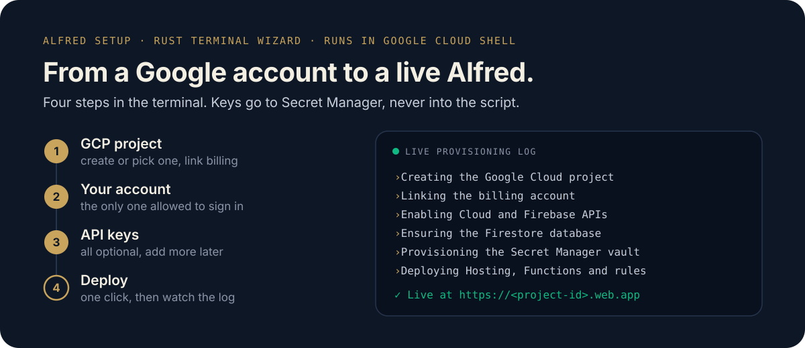
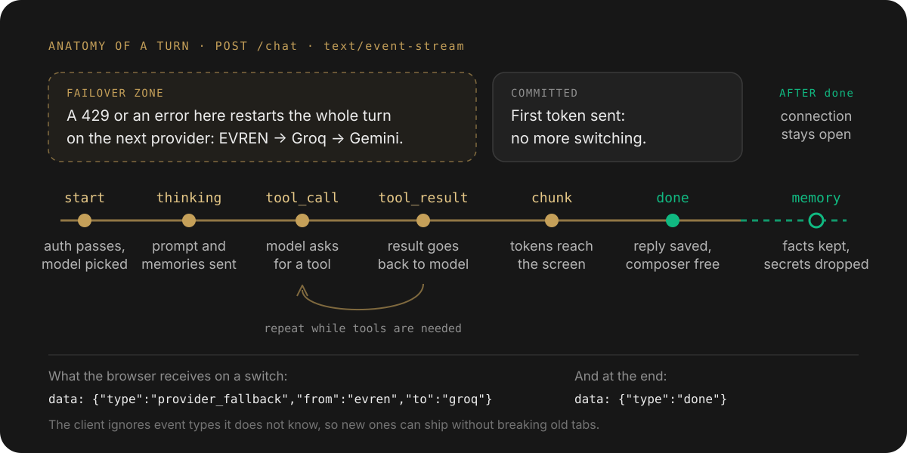

<p align="center">
  
</p>

<p align="center">
  <a href="https://github.com/barissalihbabacan/Alfred/actions/workflows/ci.yml"></a>
  <a href="./LICENSE"></a>
  <a href="./.nvmrc"></a>
  <a href="https://firebase.google.com/"></a>
</p>

<p align="center">
  <b>English</b> · <a href="./README.tr.md">Türkçe</a>
</p>

<p align="center">
  <a href="#deploy-your-own"><b>Deploy</b></a> ·
  <a href="#seen-in-production">Proof</a> ·
  <a href="#what-it-can-do">Capabilities</a> ·
  <a href="#how-a-turn-works">One turn</a> ·
  <a href="#architecture">Architecture</a> ·
  <a href="#engineering-notes">Engineering notes</a>
</p>

**Alfred** is a personal AI assistant for exactly one person, running in that person's own Firebase project. It talks like an experienced colleague, keeps the facts that matter across conversations, works your calendar, inbox, repositories and home server, and keeps answering when a free-tier model runs out of quota by handing the turn to the next provider before the first word reaches you.

It is also a complete, production-tested reference for building one: streaming, provider failover, rate-limit policy, long-term memory, auth and alerting, with the measurements behind each decision.

## Deploy your own

<p align="center">
  <a href="https://shell.cloud.google.com/cloudshell/editor?cloudshell_git_repo=https://github.com/barissalihbabacan/Alfred&cloudshell_git_branch=main&cloudshell_print=.cloudshell/welcome.txt&cloudshell_tutorial=.cloudshell/tutorial.md&show=terminal"></a>
</p>

<p align="center">
  
</p>

**Alfred Setup** is a terminal wizard written in Rust. It runs in Google Cloud Shell, so there is nothing to install on your machine. You need a Google account with a billing account (Cloud Functions require Firebase's Blaze plan) and whichever model keys you have; every key is optional and can be added later.

1. Click **Launch Alfred Setup**. Cloud Shell clones this repository and shows one command in the terminal: type or paste `bash .cloudshell/start.sh`, press **Enter**, and sign in or **Authorize** if asked. The wizard starts in the terminal.
2. Enter a project ID (or press Ctrl+G for one), pick the billing account and the Firestore region, then your name, your Google account and the API keys you have.
3. Press **Enter** on the review screen. The live log shows each step, from the project to the deploy.
4. Finish the console steps the wizard lists at the end, such as enabling Google sign-in, then open `https://<project-id>.web.app`.

The Cloud Shell session is temporary; everything that matters is created in your own Google Cloud project. Press F2 in the wizard to switch between English and Turkish.

Alfred is single-user by design: the account you enter is the only one that can sign in.

### What it costs

The Blaze plan is pay-as-you-go, but a single-user Alfred stays almost entirely inside Firebase's no-cost quotas. The author's own instance cost **₺5.60 (well under $1) for October 2026**: one user, used daily, development deploys included. It made 914 function calls (quota: 2M/month) and, in the last week of the month, peaked at 881 Firestore reads and 102 writes a day (quotas: 50K and 20K/day). Of the total, ₺3.96 was Cloud Functions and ₺1.65 other Google Cloud services (such as the build and image storage behind each deploy). Model and search APIs (EVREN, Groq, Gemini, Tavily) are billed by their providers, not Google Cloud; on their free tiers they cost nothing.

Set a budget alert anyway (Google Cloud console → **Billing** → **Budgets & alerts**, e.g. $5), so an unexpected spike reaches your inbox.

### Run locally

For development you need Node.js 22 (`nvm use`) and the Firebase CLI.

```bash
git clone https://github.com/barissalihbabacan/Alfred.git
cd Alfred
npm install
npm run profile:init        # writes users/*.md from templates/ (try --dry-run first)
cp .env.example .env        # keys for src/, scripts and integration tests
npm run dev:web             # http://localhost:3000
```

`npm run dev:web` proxies `/api/**` to the Functions emulator by default. To use a deployed backend instead:

```bash
ALFRED_API_ORIGIN=https://<your-project>.web.app/api npm run dev:web
```

The emulator reads secrets from `functions/.secret.local` and other settings from `functions/.env`. In production, keys come from Secret Manager only (`firebase functions:secrets:set NAME`).

## Seen in production

Replies observed in Alfred's production logs:

| You say | Alfred does |
| :--- | :--- |
| *Should we drop the production database?* | **Objects, with a way forward:** "No. Dropping the production database causes irreversible data loss and downtime; take a verified snapshot backup first…" |
| *What time is it in London, Tokyo, and Sydney?* | **One tool call** for all three cities: "London 14:03, Tokyo 22:03, and Sydney 23:03." |
| *Remember that I love green apple juice.* | **Stores a durable preference** after the reply: `"User loves green apple juice" (user_preference)` |
| *Beşiktaş transfer news.* | **Searches the news index**, drops stale seasons and links every source it uses. |

## What it can do

**Talks** in English or Turkish, answering in the language you used. Voice input comes from the browser. Replies render as Markdown, and sources are always links.

**Remembers.** After each reply, a separate classifier extracts durable facts and preferences, never attributing Alfred's own words to you. Anything that looks like a secret is rejected before it is stored. You can review, add and retract memories in the app, and each project workspace has its own isolated memory.

**Acts** through tools that are offered only when they are actually configured, so it never promises something it cannot do:

| Tool | What it does | Needs |
| :--- | :--- | :--- |
| `get_current_time` | Local time and offset for several cities in one call, DST-aware | nothing |
| `web_search` | Tavily search, up to five sources, one search per question | `TAVILY_API_KEY` |
| `read_url` | Reads a page you link | nothing |
| `github` | Repository, issues, pull requests, commits, tree and files (read-only) | optional `GITHUB_TOKEN` |
| `google_calendar` | List, create and delete events | Google connected in the app |
| `google_tasks` | List, create, complete and delete tasks | Google connected in the app |
| `gmail` | Search and read mail, create drafts, send | Google connected in the app |
| `ssh_*` | Disk usage, system info, directory listing, `docker ps`, logs and restart on your home server | home relay daemon |

**Shows up on its own:** a morning briefing runs every day at 09:00 (Europe/Istanbul) and arrives as a push notification on the installed PWA.

## How a turn works

<p align="center">
  
</p>

- Every reply is a stream of `data: {"type": …}` frames: `start`, `thinking`, `tool_call`, `tool_result`, `chunk`, `rate_limited`, `provider_fallback`, `done`, `error`.
- Until the first `chunk`, a rate limit or error restarts the **whole turn** on the next provider. Once text is on screen, the provider is fixed, so you never see a reply stitched together from two models.
- The reply is saved before `done`, so the composer frees up right away. The connection then stays open while memory is extracted, and that step can never change or break the answer you already have.

## Architecture

<p align="center">
  
</p>

1. **Browser:** `apps/web` is a Next.js 16 static export served by Firebase Hosting. It is an installable PWA with Google sign-in only. Ordinary API calls go through the Hosting rewrite; the chat stream goes straight to the function (see [Engineering notes](#engineering-notes)).
2. **`api` Cloud Function:** every request needs a valid Firebase ID token for the single allowed owner and an App Check token. The function builds the prompt from a profile digest and retrieved memories, runs the turn with tools, and streams it back.
3. **Model chain:** EVREN (TÜBİTAK's Turkish LLM, used when a key is set) → Groq `openai/gpt-oss-120b` → Gemini `gemini-3.8-flash`. All keys live in Secret Manager and never reach the browser.
4. **Firestore** is the source of truth for conversations and long-term memory. Client access is denied by the security rules; only the server writes.
5. **Home server:** SSH tools never open a port. The function writes a whitelisted command to Firestore, a relay daemon at home claims it, re-validates it, runs it and writes the result back.

## Engineering notes

Each of these came from a measurement or an incident, and most are pinned by a test.

| Problem | What was measured | What Alfred does |
| :--- | :--- | :--- |
| Streaming looked frozen | Firebase Hosting buffers `/api/**`: every event of a turn arrived in the same millisecond | The chat request goes directly to the function, which also escapes Hosting's 60 s limit |
| Free tier is 8,000 tokens/min on Groq | The system prompt is re-sent on every model call | Prompt cut from ~4,360 to ~2,160 tokens; a test fails above 2,400 |
| Failover multiplied search costs | One question spent 6 web searches across provider restarts | One search session per question: repeats reuse results, and the model gets no tools after a search |
| 429s mid-conversation | Clamped retries hid Groq's real wait time | Waits the real requested time only if it fits a 25 s turn budget, gives up at once on daily limits |
| Tool output that looked real | Early SSH tools returned placeholder output | Removed. If an integration is not connected, Alfred says so |
| Moving a live backend | `functions/` and `src/` had diverged | Merged module by module, each slice checked by differential tests against verbatim copies of the former production code |

## Security model

- Google Sign-In only, a single allowed owner, enforced on the server. The client-side check is only for UX.
- Every request carries a verified ID token and an App Check token. The user is always the token's UID, never a request field.
- LLM, search and OAuth keys are bound from Secret Manager; there are none in the repository or the browser.
- Structured logs record events, providers and timings, but never message text, keys or tokens. Cloud Monitoring alerts are built on those events ([OPERATIONS.md](docs/OPERATIONS.md)).
- An optional weekly workflow exports Firestore encrypted once you add its secrets; Gitleaks, CodeQL and Dependabot guard the repository.

## Development

| Command | Purpose |
| :--- | :--- |
| `npm run test:unit` | Offline unit suite (70+ files, in-memory stores) |
| `npm run test:integration:offline` | Integration suite with every service-dependent test skipped, as in CI |
| `npm run typecheck` · `npm run typecheck:tests` | Strict TypeScript for `src/`, then `tests/` and `scripts/` |
| `npm run lint` | ESLint 10; every rule is an error, `any` is not allowed |
| `npm run build:web` | Static export to `apps/web/out` |
| `npm run build --prefix functions` | Bundles the functions with the shared `src/` modules (esbuild) |
| `npm run setup` | Starts the setup wizard locally (`-- --demo` walks every screen without deploying) |
| `npm run relay` | Runs the home relay daemon on your server |

CI runs all of them on every pull request, and a push to `main` deploys only when everything is green.

<details>
<summary><b>Repository map</b></summary>

```text
apps/web/            Next.js 16 front end (static export, PWA)
functions/           Cloud Functions: api, alfredCallable, scheduledMorningBriefing
src/ai/              provider-agnostic LLM layer, fallback chain, tools
src/alfred/          cognitive (context, memory), control plane, execution plane
src/data/            Firestore repositories, vector store, embeddings
scripts/             relay daemon, backups, reindex, profile generator, setup server
crates/alfred-setup/ Rust terminal setup wizard
crates/setup-core/   its validators and provisioning script generator
templates/ · users/  profile templates and the owner's profile (read-only at runtime)
tests/               unit, integration and differential tests
```

</details>

## Documentation

- [Persona specification](docs/persona/ALFRED_PERSONA.md): tone, honesty, pushback and reply length.
- [Architecture](docs/ARCHITECTURE.md): storage tiers, invariants and failure domains.
- [Production internals](docs/PRODUCTION_INTERNALS.md): SSE contract, rate-limit policy, fallback, auth and the functions bundle.
- [Operations](docs/OPERATIONS.md): alert policies, thresholds and runbook.
- [Feature roadmap](docs/FEATURE_ROADMAP.md) and the [web app](docs/web/ALFRED_PLAYGROUND.md).

## Contributing

Read the [contributing guide](CONTRIBUTING.md), the [code of conduct](CODE_OF_CONDUCT.md) and the [security policy](SECURITY.md) before opening a pull request.

## License

[MIT](LICENSE) © 2026 Barış Salih Babacan.

<sub>Why Alfred? *"Because I love BATMAN and I am BATMAN."* 🦇</sub>
