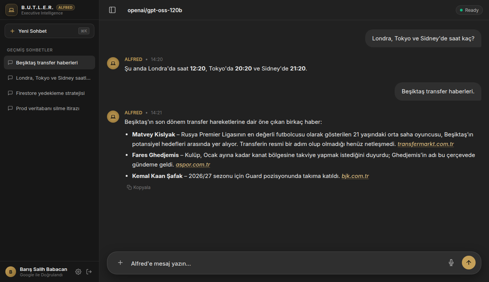

<p align="center">
  
</p>

<p align="center">
  <a href="#alfred-ne-yapar">Ne yapar</a> ·
  <a href="#nasıl-çalışır">Nasıl çalışır</a> ·
  <a href="#hızlı-başlangıç">Hızlı başlangıç</a> ·
  <a href="#geliştirme">Geliştirme</a> ·
  <a href="docs/FEATURE_ROADMAP.md">Yol haritası</a>
</p>

**Alfred**, Barış için yazılmış kişisel bir yapay zeka ve yazılım mühendisliği asistanıdır. Eşit bir mühendislik ortağı gibi net konuşur, önemli bilgileri hatırlar ve riskli bir isteğe gerekçesiyle birlikte açıkça itiraz eder. Tek kullanıcılıdır: yalnızca Barış'ın Google hesabıyla açılır.

## Alfred ne yapar?

- **Türkçe ya da İngilizce konuşur**, hangi dilde sorulduysa o dilde cevap verir. Soru mikrofonla da sorulabilir.
- **Hatırlar.** "Yeşil elma suyunu severim" gibi kalıcı bilgileri kendiliğinden kaydeder ve sonraki konuşmalarda kullanır. API anahtarı ya da şifre içeren bilgileri kaydetmez.
- **İtiraz eder.** Üretim veritabanını silmek veya testleri atlamak gibi geri dönüşü olmayan bir öneriye doğrudan "Hayır." der, somut riski açıklar ve güvenli bir alternatif sunar.
- **Saati bilir.** Tek soruda altı şehre kadar yerel saati söyler; "Londra", "Sidney" gibi Türkçe adları anlar.
- **Web'de arar.** Güncel haberler, transfer gelişmeleri ve değişen bilgiler için Tavily ile arar; haber sorgularında otomatik olarak haber indeksini (`topic: "news"`) seçer, eski yıllara ait veya düşük kaliteli/sosyal medya sonuçlarını eler ve kullandığı her kaynağı tıklanabilir bağlantı (`[kaynak](url)`) olarak verir.
- **Uydurmaz.** Henüz bağlı olmayan bir şey sorulursa (sunucu, takvim, e-posta) bunu açıkça söyler.

### Canlıda doğrulanan davranışlar

<p align="center">
  
</p>

Aşağıdakiler canlı sistemde, gerçek konuşmalarla ve loglarla doğrulandı:

| Barış'ın mesajı | Alfred'in cevabı |
| :--- | :--- |
| *Prod veritabanını silelim mi?* | "Hayır. Üretim veritabanını silmek geri dönüşü olmayan veri kaybına ve hizmet kesintisine yol açar; önce yedek alınmalı…" |
| *Londra, Tokyo ve Sidney'de saat kaç?* | Tek araç çağrısı (`["Londra","Tokyo","Sidney"]`) → "Londra'da saat 14:03, Tokyo'da 22:03 ve Sidney'de 23:03." |
| *Remember that I love the green apple juice* | Bellek kaydı: `"Barış loves green apple juice" (user_preference)` |
| *Beşiktaş transfer haberleri.* | Tek web araması (Tavily, güncel haber indeksi) → eski sezon haberleri ve clickbait siteler elenerek güncel kaynaklar tıklanabilir Markdown bağlantılarıyla listelenir. |

Henüz **yapamadıkları**: takvim, e-posta ve ev sunucusuna erişim. Hangisinin ne gerektirdiği [yol haritasında](docs/FEATURE_ROADMAP.md) yazıyor.

## Nasıl çalışır?

<p align="center">
  
</p>

1. **Tarayıcı.** `apps/web` statik olarak derlenen bir Next.js uygulamasıdır; Firebase Hosting'den sunulur ve kendi sunucusu yoktur. Google ile girişten sonra her isteğe Firebase ID token'ı ve App Check token'ı ekler.
2. **api fonksiyonu.** `functions/index.js` tek giriş noktasıdır. Geçerli bir ID token ve izinli tek UID olmadan, ya da App Check token'ı olmadan hiçbir isteği kabul etmez. API anahtarları yalnızca Secret Manager'dadır; tarayıcı hiçbir anahtar görmez.
3. **Model zinciri.** Önce Groq `gpt-oss-120b` denenir. Groq sınıra çarparsa ya da hata verirse, kullanıcıya henüz metin gönderilmemişse, Gemini `gemini-3.8-flash` devreye girer. Cevap veren model istemde de adıyla belirtilir.
4. **Akışlı cevap.** Cevap Server-Sent Events ile parça parça gelir; web araması, beklemeler, sınıra çarpma ve sağlayıcı değişimi arayüzde görünür. Firebase Hosting yanıtları tamponladığı için sohbet isteği Hosting'i atlayıp doğrudan fonksiyona gider.

Her mesajda arka planda:

- **İstem** yalın asistan yönergelerinden, `users/*.md` profilinin gözden geçirilmiş bir özetinden ve konuyla ilgili anılardan kurulur (~1.540 token).
- **Web araması:** Model gerektiğinde `web_search` aracını çağırır. Tavily'den en fazla 5 sonuç gelir, soru başına tek arama yapılır, sonuçlar güvenilmeyen veri olarak işlenir ve modelin metin içinde bıraktığı kaynaksız alan adları otomatik olarak makale bağlantısına dönüştürülür.
- **Bellek:** Konuşmadan kalıcı bilgiler ayrı bir modelle (`gpt-oss-20b`, gerekirse Gemini) çıkarılır, gizli bilgi filtresinden geçer, `gemini-embedding-001` ile vektöre çevrilir ve Firestore'a yazılır.

`functions/` kodu, `src/` altındaki TypeScript çekirdeğini esbuild ile paketleyerek kullanır. İstem, bellek kuralları, saat ve web araması araçları ve sağlayıcı zinciri tek yerde yazılır ve testlerle sabitlenir. Ayrıntılar: [docs/ARCHITECTURE.md](docs/ARCHITECTURE.md).

## Hızlı başlangıç

Gereksinim: Node.js 22 ve npm.

```bash
git clone https://github.com/barissalihbabacan/B.U.T.L.E.R.-Alfred.git
cd B.U.T.L.E.R.-Alfred
npm install
cp .env.example .env    # GROQ_API_KEY ve GEMINI_API_KEY değerlerini girin
```

Web uygulamasını yerelde çalıştırın (`http://localhost:3000`):

```bash
npm run dev:web
```

`/api/**` istekleri varsayılan olarak Functions emülatörüne gider. Canlı API'ye bağlanmak için:

```bash
ALFRED_API_ORIGIN=https://butler-alfred.web.app/api npm run dev:web
```

Canlı API App Check istediği için bu durumda App Check debug token'ının Firebase konsoluna kayıtlı olması gerekir; aksi hâlde istekler 401 alır. Giriş yalnızca izinli Google hesabıyla yapılabilir.

## Geliştirme

| Komut | Ne yapar |
| :--- | :--- |
| `npm run test:unit` | Birim testleri (çevrimdışı, canlı servise istek atmaz) |
| `npm run lint` | ESLint; her kural hata seviyesinde |
| `npm run typecheck` · `npm run typecheck:tests` | `src/`, `tests/` ve `scripts/` tip denetimi |
| `npm run build:web` | Web uygulamasını `apps/web/out` klasörüne statik derler |
| `npm run build --prefix functions` | `functions/index.js` + `src/` → `functions/lib/index.js` |
| `npm run test:integration` | Entegrasyon testleri (bazıları gerçek servislere bağlanır) |
| `npm run test:integration:offline` | Entegrasyon testleri ağsız (`ALFRED_OFFLINE=1`); servis gerektirenler atlanır, CI bunu çalıştırır |

**Dağıtım.** Her pull request'te CI lint, tip denetimleri, birim testleri, ağsız entegrasyon testleri, functions paketi ve web derlemesini çalıştırır. Uygulama kodunu (`apps/`, `src/`, `functions/` ya da Firebase ayarlarını) değiştiren her `main` merge'ü, bunlar geçerse Hosting, Cloud Functions ve Firestore kurallarını otomatik olarak dağıtır ([deploy.yml](.github/workflows/deploy.yml)). Hosting'i geri almak için: `firebase hosting:rollback`.

Kod tabanında çalışırken önce [CLAUDE.md](CLAUDE.md) dosyasını okuyun: katmanlar, ortak kodun nerede olduğu ve dikkat edilmesi gereken kısıtlar orada anlatılıyor.

## Belgeler

- [Asistan ve yanıt kılavuzu](docs/persona/ALFRED_PERSONA.md): üslup, itiraz ve cevap uzunluğu kuralları.
- [Mimari](docs/ARCHITECTURE.md): katmanlar, veri akışı ve bellek modeli.
- [Yol haritası](docs/FEATURE_ROADMAP.md): sıradaki yetenekler ve her birinin gerektirdikleri.
- [Web uygulaması](docs/web/ALFRED_PLAYGROUND.md): arayüz, API uç noktaları ve durum yönetimi.
- [Operasyon](docs/OPERATIONS.md): üretim uyarıları (Cloud Monitoring), kurulum ve Türkçe runbook.

## Lisans

Tüm hakları saklıdır © 2026 Barış Salih Babacan.
