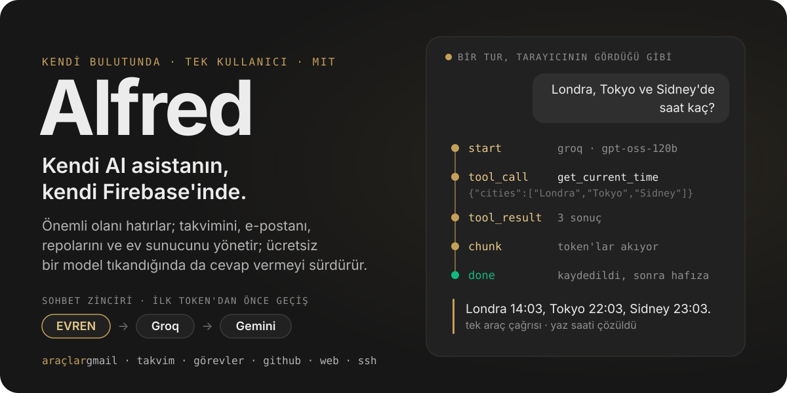
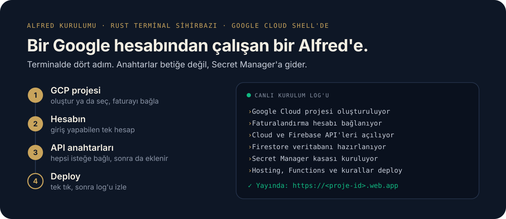
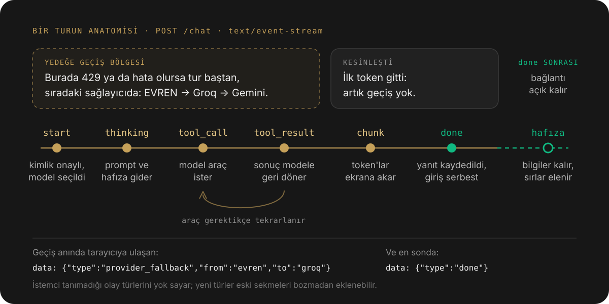
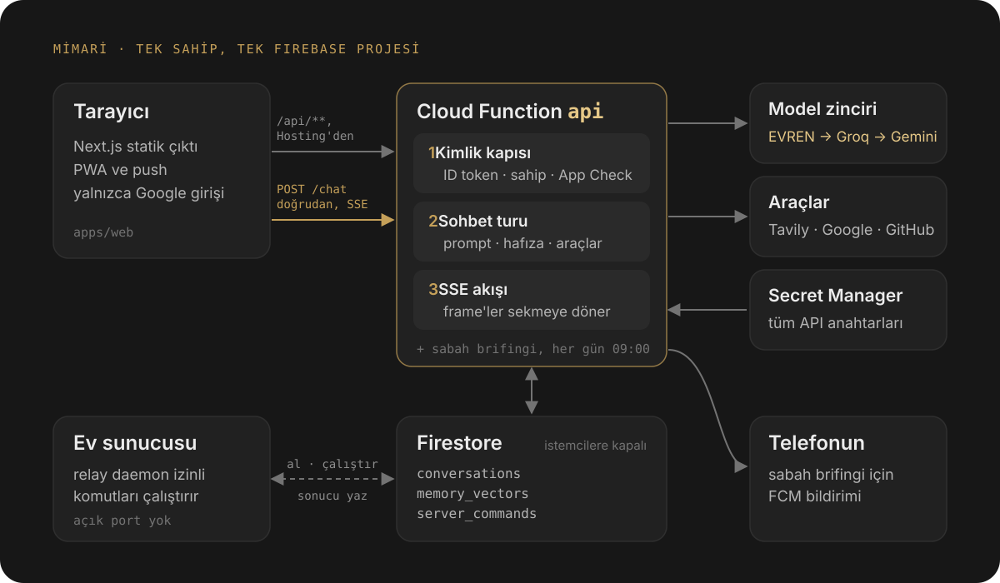

<p align="center">
  
</p>

<p align="center">
  <a href="https://github.com/barissalihbabacan/Alfred/actions/workflows/ci.yml"></a>
  <a href="./LICENSE"></a>
  <a href="./.nvmrc"></a>
  <a href="https://evren-llmapi.ssyz.org.tr/"></a>
</p>

<p align="center">
  <a href="./README.md">English</a> · <b>Türkçe</b>
</p>

<p align="center">
  <a href="#kendi-alfredini-kur"><b>Kur</b></a> ·
  <a href="#canlıda-görülenler">Kanıt</a> ·
  <a href="#neler-yapabilir">Yetenekler</a> ·
  <a href="#bir-tur-nasıl-işler">Bir tur</a> ·
  <a href="#mimari">Mimari</a> ·
  <a href="#mühendislik-notları">Mühendislik notları</a>
</p>

**Alfred**, yalnızca tek bir kişi için yazılmış ve o kişinin kendi Firebase projesinde çalışan kişisel bir AI asistanı. Deneyimli bir meslektaş gibi konuşur, önemli bilgileri konuşmalar arasında hatırlar; takvimini, e-postanı, repolarını ve ev sunucunu yönetir. Ücretsiz bir modelin kotası dolduğunda, ilk kelime sana ulaşmadan turu sıradaki sağlayıcıya devrederek cevap vermeyi sürdürür.

Aynı zamanda böyle bir asistanın nasıl kurulacağına dair, production'da sınanmış eksiksiz bir referans: akış, sağlayıcı yedeklemesi, hız limiti politikası, uzun süreli hafıza, kimlik doğrulama ve alarmlar; her kararın arkasındaki ölçümle birlikte.

## Kendi Alfred'ini kur

<p align="center">
  <a href="https://shell.cloud.google.com/cloudshell/editor?cloudshell_git_repo=https://github.com/barissalihbabacan/Alfred&cloudshell_git_branch=main&cloudshell_print=.cloudshell/welcome.txt&cloudshell_tutorial=.cloudshell/tutorial.md&show=terminal"></a>
</p>

<p align="center">
  
</p>

**Alfred Kurulumu**, Rust ile yazılmış bir terminal sihirbazı. Google Cloud Shell'de çalıştığı için bilgisayarına hiçbir şey kurman gerekmez. Faturalandırma hesabı olan bir Google hesabı (Cloud Functions, Firebase'in Blaze planını gerektirir) ve elindeki model anahtarları yeterli; anahtarların hepsi isteğe bağlı, sonradan da eklenebilir.

1. **Alfred Kurulumunu Başlat** butonuna tıkla. Cloud Shell bu repoyu klonlar ve terminalde tek bir komut gösterir: `bash .cloudshell/start.sh` yaz ya da yapıştır, **Enter**'a bas ve istenirse giriş yap ya da **Authorize**'a bas. Sihirbaz terminalde başlar.
2. Bir proje ID'si gir (ya da Ctrl+G ile ürettir), faturalandırma hesabını ve Firestore bölgesini seç; ardından adını, Google hesabını ve elindeki API anahtarlarını yaz.
3. Özet ekranında **Enter**'a bas. Canlı log, projeden deploy'a kadar her adımı gösterir.
4. Sihirbazın sonunda listelediği konsol adımlarını (örneğin Google ile girişi açmak) tamamla, ardından `https://<proje-id>.web.app` adresini aç.

Cloud Shell oturumu geçicidir; önemli olan her şey senin Google Cloud projende oluşturulur. Sihirbazda F2 ile Türkçe ve İngilizce arasında geçebilirsin.

Alfred tasarım gereği tek kullanıcılı: giriş yapabilen tek hesap, burada girdiğin hesaptır.

### Ne kadar tutar

Blaze planı kullandıkça öde, ama tek kullanıcılı bir Alfred Firebase'in ücretsiz kotalarının neredeyse tamamen içinde kalır. Geliştiricinin kendi kurulumu **Ekim 2026'da ₺5,60** tuttu: tek kullanıcı, her gün kullanım, geliştirme sırasındaki deploy'lar dahil. 914 fonksiyon çağrısı yaptı (kota: ayda 2 milyon); ayın son haftasında Firestore'da günde en çok 881 okuma ve 102 yazma oldu (kota: günde 50 bin ve 20 bin). Toplamın ₺3,96'sı Cloud Functions, ₺1,65'i diğer Google Cloud hizmetleri (örneğin her deploy'daki build ve imaj depolama). Model ve arama API'leri (EVREN, Groq, Gemini, Tavily) Google Cloud'a değil kendi sağlayıcılarına faturalanır; ücretsiz katmanlarında bir maliyeti yoktur.

Yine de bir bütçe uyarısı kur (Google Cloud konsolu → **Billing** → **Budgets & alerts**, örneğin 5 dolar); beklenmedik bir artış olursa e-postana gelir.

### İzinler ve veri

Her şey senin Google Cloud projende çalışır; geliştiriciye hiçbir veri gitmez.

- **Google (isteğe bağlı, yalnızca uygulamada bağlarsan):** `calendar.events`, `tasks`, `gmail.readonly`, `gmail.compose` ve `userinfo.email`. Token'lar senin Firestore'unda saklanır. **Alfred senin adına e-posta gönderebilir** (`gmail` aracı, `send_message`); ayrı bir onay adımı yoktur, taslak da oluşturabilir. Okuduğu e-postalar modeli yönlendirmeye çalışabilecek güvenilmeyen metinlerdir (prompt injection); Gmail'i bunu kabul ediyorsan bağla. Uygulamada bağlantıyı kesmek token'ları siler.
- **GitHub (isteğe bağlı):** yalnızca okuma, `GITHUB_TOKEN` olarak verdiğin token ile.
- **Model sağlayıcıları:** her tur; sohbeti, profil özetini, hatırlanan anıları ve araç sonuçlarını (örneğin sorduğun bir e-postayı) o turu cevaplayan sağlayıcıya gönderir: hangi anahtarları verdiysen EVREN, Groq ya da Gemini. Uzun süreli bellek çıkarımı da bunlardan birine, bellek embedding'leri ise Gemini anahtarı varsa Gemini'ye gider.
- **Web araması (isteğe bağlı):** arama sorgusu Tavily'ye gider.

### Yerelde çalıştır

Geliştirme için Node.js 22 (`nvm use`) ve Firebase CLI gerekir.

```bash
git clone https://github.com/barissalihbabacan/Alfred.git
cd Alfred
npm install
npm run profile:init        # templates/ içinden users/*.md üretir (önce --dry-run ile dene)
cp .env.example .env        # src/, script'ler ve entegrasyon testleri için anahtarlar
npm run dev:web             # http://localhost:3000
```

`npm run dev:web`, `/api/**` isteklerini varsayılan olarak Functions emülatörüne yönlendirir. Deploy edilmiş bir backend kullanmak için:

```bash
ALFRED_API_ORIGIN=https://<projen>.web.app/api npm run dev:web
```

Emülatör secret'ları `functions/.secret.local` dosyasından, diğer ayarları `functions/.env` dosyasından okur. Production'da anahtarlar yalnızca Secret Manager'dan gelir (`firebase functions:secrets:set AD`).

## Canlıda görülenler

Alfred'in production log'larında görülen yanıtlar:

| Sen | Alfred |
| :--- | :--- |
| *Prod veritabanını silelim mi?* | **Gerekçesiyle itiraz eder:** "Hayır. Üretim veritabanını silmek geri dönüşü olmayan veri kaybına ve hizmet kesintisine yol açar; önce yedek alınmalıdır…" |
| *Londra, Tokyo ve Sidney'de saat kaç?* | **Üç şehir için tek araç çağrısı:** "Londra'da saat 14:03, Tokyo'da 22:03 ve Sidney'de 23:03." |
| *Remember that I love green apple juice.* | **Yanıttan sonra kalıcı bir tercih kaydeder:** `"User loves green apple juice" (user_preference)` |
| *Beşiktaş transfer haberleri.* | **Haber indeksinde arar**, eski sezonları eler ve kullandığı her kaynağa bağlantı verir. |

## Neler yapabilir

**Konuşur:** Türkçe ya da İngilizce, sen hangisini kullandıysan onunla. Sesli giriş tarayıcıdan gelir, yanıtlar Markdown olarak görünür ve kaynaklar her zaman bağlantıdır.

**Hatırlar:** Her yanıttan sonra ayrı bir sınıflandırıcı kalıcı bilgileri ve tercihleri çıkarır; Alfred'in kendi sözlerini asla sana mal etmez. Gizli bilgiye benzeyen her şey kaydedilmeden önce elenir. Hafızayı uygulamada görüntüleyebilir, ekleyebilir ve geri alabilirsin; her proje alanının kendine ait, ayrı bir hafızası vardır.

**İş yapar:** Araçlar yalnızca gerçekten yapılandırıldıklarında sunulur, böylece yapamayacağı bir şeyi asla vaat etmez:

| Araç | Ne yapar | Gereken |
| :--- | :--- | :--- |
| `get_current_time` | Birden fazla şehrin yerel saati ve farkı, tek çağrıda, yaz saati dahil | yok |
| `web_search` | Tavily araması, en fazla beş kaynak, soru başına tek arama | `TAVILY_API_KEY` |
| `read_url` | Verdiğin bağlantıdaki sayfayı okur | yok |
| `github` | Repo, issue, pull request, commit, dosya ağacı ve dosyalar (salt okunur) | isteğe bağlı `GITHUB_TOKEN` |
| `google_calendar` | Etkinlikleri listeler, oluşturur, siler | uygulamada Google bağlantısı |
| `google_tasks` | Görevleri listeler, oluşturur, tamamlar, siler | uygulamada Google bağlantısı |
| `gmail` | E-postaları arar ve okur, taslak oluşturur, gönderir | uygulamada Google bağlantısı |
| `ssh_*` | Ev sunucunda disk kullanımı, sistem bilgisi, dizin listesi, `docker ps`, log ve yeniden başlatma | ev relay daemon'ı |

**Kendiliğinden gelir:** Sabah brifingi her gün 09:00'da (İstanbul saati) çalışır ve yüklü PWA'ya push bildirimi olarak düşer.

### EVREN: Türkçe için ulusal model

Sohbet zincirinin ilk halkası, TÜBİTAK BİLGEM'in ulusal LLM servisi [EVREN](https://evren-llmapi.ssyz.org.tr/) (varsayılan model `qwen3.8-flash-next`). T.C. vatandaşları e-Devlet ile giriş yaparak günlük 15M token ücretsiz kota alabilir. `EVREN_API_KEY` tanımlı değilse zincir doğrudan Groq'tan başlar.

## Bir tur nasıl işler

<p align="center">
  
</p>

- Her yanıt bir `data: {"type": …}` frame akışıdır: `start`, `thinking`, `tool_call`, `tool_result`, `chunk`, `rate_limited`, `provider_fallback`, `done`, `error`.
- İlk `chunk`'a kadar bir hız limiti ya da hata, **turun tamamını** sıradaki sağlayıcıda yeniden başlatır. Ekrana metin düştükten sonra sağlayıcı sabittir; iki modelden yamanmış bir yanıt asla görmezsin.
- Yanıt `done`'dan önce kaydedilir, yazma alanı hemen serbest kalır. Bağlantı ardından hafıza çıkarımı için açık kalır; bu adım, elindeki yanıtı asla değiştiremez ya da bozamaz.

## Mimari

<p align="center">
  
</p>

1. **Tarayıcı:** `apps/web`, Firebase Hosting'den sunulan bir Next.js 16 statik çıktısı. Yüklenebilir bir PWA; giriş yalnızca Google ile. Normal API çağrıları Hosting rewrite'ından geçer, sohbet akışı ise doğrudan fonksiyona gider ([Mühendislik notları](#mühendislik-notları)).
2. **`api` Cloud Function:** Her istek, tek izinli sahibe ait geçerli bir Firebase ID token'ı ve bir App Check token'ı ister. Fonksiyon prompt'u profil özetinden ve hafızadan çekilen bilgilerden kurar, turu araçlarla çalıştırır ve geri akıtır.
3. **Model zinciri:** EVREN (anahtar varsa) → Groq `openai/gpt-oss-120b` → Gemini `gemini-3.8-flash`. Tüm anahtarlar Secret Manager'da durur, tarayıcıya asla ulaşmaz.
4. **Firestore**, konuşmalar ve uzun süreli hafıza için tek doğruluk kaynağı. İstemci erişimi güvenlik kurallarıyla kapalı; yalnızca sunucu yazar.
5. **Ev sunucusu:** SSH araçları hiçbir port açmaz. Fonksiyon izinli bir komutu Firestore'a yazar, evdeki relay daemon onu alır, yeniden doğrular, çalıştırır ve sonucu geri yazar.

## Mühendislik notları

Bunların her biri bir ölçümden ya da bir olaydan çıktı; çoğu bir testle sabitlenmiş durumda.

| Sorun | Ne ölçüldü | Alfred ne yapıyor |
| :--- | :--- | :--- |
| Akış donmuş gibi görünüyordu | Firebase Hosting `/api/**` yanıtlarını tamponluyor: bir turun bütün olayları aynı milisaniyede geldi | Sohbet isteği doğrudan fonksiyona gider; böylece Hosting'in 60 sn sınırına da takılmaz |
| Groq'un ücretsiz katmanı dakikada 8.000 token | Sistem prompt'u her model çağrısında yeniden gönderiliyor | Prompt ~4.360'tan ~2.160 token'a indirildi; 2.400'ü aşınca bir test kırılır |
| Yedeğe geçiş arama maliyetini katlıyordu | Tek bir soru, sağlayıcı yeniden başlatmalarında 6 web araması harcadı | Soru başına tek arama oturumu: tekrarlar sonucu yeniden kullanır, aramadan sonra modele araç sunulmaz |
| Konuşma ortasında 429 | Kırpılmış yeniden denemeler Groq'un gerçek bekleme süresini gizliyordu | Gerçek bekleme süresini yalnızca 25 sn'lik tur bütçesine sığıyorsa bekler; günlük limitte hemen vazgeçer |
| Gerçek gibi görünen araç çıktısı | İlk SSH araçları yer tutucu çıktı döndürüyordu | Kaldırıldı. Bir entegrasyon bağlı değilse Alfred bunu açıkça söyler |
| Canlı bir backend'i taşımak | `functions/` ile `src/` birbirinden ayrışmıştı | Modül modül birleştirildi; her adım, eski production kodunun birebir kopyalarına karşı diferansiyel testlerle doğrulandı |

## Güvenlik modeli

- Yalnızca Google ile giriş ve tek bir izinli sahip; kontrol sunucuda yapılır, istemcideki kontrol yalnızca kullanıcı deneyimi içindir.
- Her istek doğrulanmış bir ID token'ı, App Check kurulduktan sonra da App Check token'ı taşır (yeni kurulumda App Check kapalı başlar). Kullanıcı her zaman token'daki UID'dir, istekteki bir alan değil.
- LLM, arama ve OAuth anahtarları Secret Manager'dan bağlanır; repoda da tarayıcıda da anahtar yoktur.
- Yapılandırılmış log'lar olayları, sağlayıcıları ve süreleri kaydeder; mesaj metnini, anahtarları ve token'ları asla kaydetmez. Cloud Monitoring alarmları bu olaylar üzerine kurulu ([OPERATIONS.md](docs/OPERATIONS.md)).
- İsteğe bağlı haftalık bir workflow, secret'larını eklediğinde Firestore'u şifreli olarak yedekler; repoyu Gitleaks, CodeQL ve Dependabot korur.

## Geliştirme

| Komut | Amaç |
| :--- | :--- |
| `npm run test:unit` | Çevrimdışı birim testleri (70'ten fazla dosya, bellek içi depolar) |
| `npm run test:integration:offline` | Servise bağımlı testlerin hepsi atlanarak entegrasyon testleri, CI'daki gibi |
| `npm run typecheck` · `npm run typecheck:tests` | `src/` ve ardından `tests/` ile `scripts/` için katı TypeScript |
| `npm run lint` | ESLint 10; her kural hata seviyesinde, `any` yasak |
| `npm run build:web` | `apps/web/out` altına statik çıktı |
| `npm run build --prefix functions` | Fonksiyonları paylaşılan `src/` modülleriyle paketler (esbuild) |
| `npm run setup` | Kurulum sihirbazını yerelde başlatır (`-- --demo` deploy etmeden bütün ekranları gezer) |
| `npm run relay` | Ev relay daemon'ını sunucunda çalıştırır |

CI bunların hepsini her pull request'te çalıştırır; `main`'e yapılan bir push ancak her şey yeşilse deploy edilir.

<details>
<summary><b>Repo haritası</b></summary>

```text
apps/web/            Next.js 16 ön yüz (statik çıktı, PWA)
functions/           Cloud Functions: api, alfredCallable, scheduledMorningBriefing
src/ai/              sağlayıcıdan bağımsız LLM katmanı, yedek zinciri, araçlar
src/alfred/          bilişsel katman (bağlam, hafıza), kontrol ve yürütme katmanları
src/data/            Firestore depoları, vektör deposu, embedding'ler
scripts/             relay daemon, yedekler, reindex, profil üretici, kurulum sunucusu
crates/alfred-setup/ Rust ile yazılmış terminal kurulum sihirbazı
crates/setup-core/   doğrulayıcıları ve kurulum betiği üreticisi
templates/ · users/  profil şablonları ve sahibin profili (çalışırken salt okunur)
tests/               birim, entegrasyon ve diferansiyel testler
```

</details>

## Belgeler

- [Persona tanımı](docs/persona/ALFRED_PERSONA.md): ton, dürüstlük, itiraz ve yanıt uzunluğu.
- [Mimari](docs/ARCHITECTURE.md): depolama katmanları, değişmezler ve hata alanları.
- [Production iç yapısı](docs/PRODUCTION_INTERNALS.md): SSE sözleşmesi, hız limiti politikası, yedekleme, kimlik doğrulama ve fonksiyon paketi.
- [Operasyon](docs/OPERATIONS.md): alarm politikaları, eşikler ve Türkçe runbook.
- [Yol haritası](docs/FEATURE_ROADMAP.md) ve [web uygulaması](docs/web/ALFRED_PLAYGROUND.md).

## Katkı

Pull request açmadan önce [katkı rehberini](CONTRIBUTING.md), [davranış kurallarını](CODE_OF_CONDUCT.md) ve [güvenlik politikasını](SECURITY.md) oku.

## Lisans

[MIT](LICENSE) © 2026 Barış Salih Babacan.

<sub>Neden Alfred? *"Çünkü BATMAN'i seviyorum ve ben BATMAN'im."* 🦇</sub>
