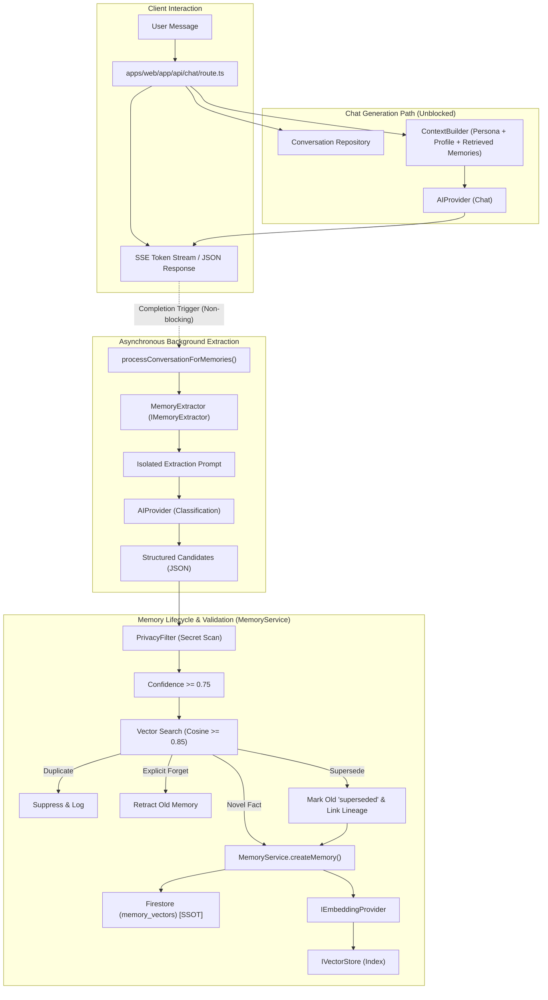

# B.U.T.L.E.R. Alfred — Autonomous Long-Term Memory Extraction Report

> **Milestone**: Autonomous Long-Term Memory Extraction from Conversations
> **Status**: ✅ Complete & Verified
> **Date**: 2026-09-06
> **Author**: Antigravity (Google DeepMind) for Barış Salih Babacan

---

## 1. Executive Summary

Alfred now features **autonomous long-term memory extraction** integrated seamlessly into the conversational runtime.

Rather than persisting every turn or storing raw transcript fragments, Alfred's cognitive layer intelligently identifies durable information (user preferences, project decisions, architectural constraints, relationships, and workflows), validates candidates through a strict privacy filter and confidence threshold, checks for semantic duplicates, manages historical memory supersession, and indexes memories via the authoritative **Firestore → Embedding → Vector Store** pipeline.

All memory extraction runs **asynchronously and non-blockingly in the background**, ensuring zero disruption to user response latency and stream delivery.

---

## 2. Verification Gate Results

| Test / Gate | Command | Result | Details |
|---|---|---|---|
| **Unit Tests** | `npm run test:unit` | ✅ **PASS** | 15 test files, **132 passed / 132 total** (100%) |
| **TypeScript Typecheck** | `npm run typecheck` | ✅ **PASS** | `tsc --noEmit` exited with code 0 (zero errors) |
| **Production Build** | `npm run build:web` | ✅ **PASS** | Next.js 14.2 production bundle created cleanly |
| **Git Working Tree** | `git status` | ✅ **PASS** | Untracked & modified files preserved for user review (no auto-commit) |

---

## 3. Files Created & Modified

### New Files Created (6)
1. [`src/alfred/cognitive/memory/extractor/types.ts`](file:///home/baris/Belgeler/B.U.T.L.E.R.%20Alfred/src/alfred/cognitive/memory/extractor/types.ts) — Contracts for memory extraction input, candidate structure, actions (`create`, `forget`, `supersede`), extractor interface (`IMemoryExtractor`), and processed results.
2. [`src/alfred/cognitive/memory/extractor/memory-extractor.ts`](file:///home/baris/Belgeler/B.U.T.L.E.R.%20Alfred/src/alfred/cognitive/memory/extractor/memory-extractor.ts) — LLM-driven memory extractor using `AIProvider` with isolated classification instructions, bounded context windows, timeout controls, and fail-open resilience.
3. [`src/alfred/cognitive/memory/privacy-filter.ts`](file:///home/baris/Belgeler/B.U.T.L.E.R.%20Alfred/src/alfred/cognitive/memory/privacy-filter.ts) — Pre-persistence security guard detecting and rejecting API keys (OpenAI, Claude, GCP, GitHub, Slack), private keys, bearer tokens, JWTs, and passwords.
4. [`src/ai/prompts/memory-extraction.ts`](file:///home/baris/Belgeler/B.U.T.L.E.R.%20Alfred/src/ai/prompts/memory-extraction.ts) — Dedicated extraction prompt isolating extraction from Alfred's persona, enforcing strict JSON output, and parsing/validating structured candidates.
5. [`tests/unit/memory-extraction.test.ts`](file:///home/baris/Belgeler/B.U.T.L.E.R.%20Alfred/tests/unit/memory-extraction.test.ts) — 17 unit tests verifying end-to-end extraction, privacy filters, duplicate detection, supersession, retractions, fast-path negative signals, and fail-open behaviors.
6. [`docs/autonomous-memory-extraction-report.md`](file:///home/baris/Belgeler/B.U.T.L.E.R.%20Alfred/docs/autonomous-memory-extraction-report.md) — This milestone documentation and review report.

### Modified Files (8)
1. [`src/data/firestore/memory.types.ts`](file:///home/baris/Belgeler/B.U.T.L.E.R.%20Alfred/src/data/firestore/memory.types.ts) — Extended `MemoryType` with `"relationship"` and `"workflow"`; added `supersedesMemoryId` and `supersededByMemoryId` lineage fields.
2. [`src/data/firestore/in-memory-memory-repository.ts`](file:///home/baris/Belgeler/B.U.T.L.E.R.%20Alfred/src/data/firestore/in-memory-memory-repository.ts) — Supported lineage tracking in in-memory test repository.
3. [`src/data/firestore/firestore-memory-repository.ts`](file:///home/baris/Belgeler/B.U.T.L.E.R.%20Alfred/src/data/firestore/firestore-memory-repository.ts) — Persisted lineage tracking and streamlined document hydration.
4. [`src/core/config/memory.config.ts`](file:///home/baris/Belgeler/B.U.T.L.E.R.%20Alfred/src/core/config/memory.config.ts) — Added `MemoryExtractionConfig` with configurable confidence, timeout, deduplication threshold, and context message bounds.
5. [`src/alfred/cognitive/memory/types.ts`](file:///home/baris/Belgeler/B.U.T.L.E.R.%20Alfred/src/alfred/cognitive/memory/types.ts) — Added `supersedesMemoryId` to `CreateMemoryInput`.
6. [`src/alfred/cognitive/memory/memory-service.ts`](file:///home/baris/Belgeler/B.U.T.L.E.R.%20Alfred/src/alfred/cognitive/memory/memory-service.ts) — Implemented `processConversationForMemories()` orchestration and `supersedeMemory()` lifecycle method.
7. [`apps/web/app/api/chat/route.ts`](file:///home/baris/Belgeler/B.U.T.L.E.R.%20Alfred/apps/web/app/api/chat/route.ts) — Hooked background autonomous extraction into both non-streaming and streaming completion paths.
8. [`docs/ARCHITECTURE.md`](file:///home/baris/Belgeler/B.U.T.L.E.R.%20Alfred/docs/ARCHITECTURE.md) — Documented end-to-end memory data flow, failure boundaries, and foundational architectural distinctions.

---

## 4. Architectural Design & Separation of Concerns

### Architecture Diagram



### Core Invariants

1. **Conversation History ≠ Long-Term Memory**:
   Conversation history records every utterance verbatim in Firestore (`conversations/{id}/messages`). Long-term memory records only durable facts, preferences, decisions, and constraints. Chit-chat, greetings, questions, and transient statements are never persisted as memories.
2. **Memory Extraction ≠ Conversational Persona**:
   The extraction subsystem uses a dedicated, objective system prompt. Alfred's conversational persona (wit, dry humour, First Principles pushback) is never mixed into extraction, and assistant utterances are never converted into facts about the user.
3. **Firestore ≠ Vector DB**:
   Firestore is the sole authoritative Single Source of Truth (SSOT). Every indexed memory has a durable document in `memory_vectors`. The vector database is a non-authoritative search cache that can be purged and rebuilt at any time via `npm run memory:reindex`.
4. **Git Profile ≠ Runtime Memory**:
   Files in `users/` (`USER_PROFILE.md`, `PREFERENCES.md`, `WORKING_STYLE.md`) are canonical, Git-versioned, and strictly read-only at runtime. Dynamic memory extraction operates exclusively in Firestore.

---

## 5. Detailed Component Specifications

### 5.1 MemoryExtractor (`IMemoryExtractor`)
- **Bounded Context**: Extracts only the current exchange plus up to `MEMORY_EXTRACTION_MAX_MESSAGES` (default 6) previous messages.
- **Fast-Path Negative Signals**: Explicit user rejection phrases ("don't remember this", "bunu hatırlama", "sakın kaydetme") bypass LLM calls entirely and return `{ shouldRemember: false, candidates: [] }`.
- **Low Temperature**: Model called with `temperature: 0.1` and strict JSON schema prompt to maximize deterministic classification.
- **Fail-Open Resilience**: If the AI provider is unconfigured, throws an error, or times out, the extractor logs a warning and returns an empty list.

### 5.2 Extraction Prompt & Structured Schema
The prompt instructs the model to return JSON conforming to:
```json
{
  "shouldRemember": true,
  "memories": [
    {
      "content": "Barış prefers TypeScript for application development.",
      "memoryType": "user_preference",
      "confidence": 0.95,
      "action": "create",
      "targetMemoryHint": "...",
      "reasoning": "Explicit user preference statement"
    }
  ]
}
```

### 5.3 Memory Types
Reuses and minimally extends `MemoryType`:
- `user_preference`: User likes, dislikes, communication styles, coding preferences.
- `user_fact`: Enduring facts about Barış's background, equipment, location, or setup.
- `project_fact`: Technical choices, stack decisions, or repository realities.
- `architectural_decision`: Deliberate design patterns, trade-offs, and invariants.
- `technical_preference`: Specific engineering preferences (frameworks, paradigms).
- `constraint`: Critical system, security, or business constraints.
- `relationship`: Professional relationships and stakeholder context.
- `workflow`: Habitual engineering workflows (TDD, easy-to-hard, vertical slices).
- `general`: General long-term context.

### 5.4 Privacy & Secret Protection (`PrivacyFilter`)
Scans all candidates prior to persistence using high-precision regular expressions:
- OpenAI / Claude API keys (`sk-[a-zA-Z0-9_-]{20,}`, `AIza...`)
- GitHub / GitLab tokens (`ghp_...`, `glpat-...`)
- Private key blocks (`-----BEGIN ... PRIVATE KEY-----`)
- Bearer tokens and JWTs (`bearer ...`, `eyJ...`)
- Explicit password/secret strings (`password = ...`)
Any candidate triggering these patterns is rejected and logged without printing the sensitive text.

### 5.5 Deduplication & Supersession Engine
- **Semantic Deduplication**: Performs a vector search for related memories matching the candidate. If an active memory has cosine similarity $\ge 0.85$, the candidate is suppressed as a duplicate.
- **Lineage Supersession**: When a user updates a fact ("We switched from Jenkins to GitHub Actions"), the extractor emits `action: "supersede"`. MemoryService:
  1. Locates the previous memory in Firestore.
  2. Updates the old memory's status to `"superseded"` and records `supersededByMemoryId`.
  3. Deletes the old memory from the vector index so it is no longer retrieved for active queries.
  4. Creates the new memory with `supersedesMemoryId` linking back to the old memory.
- **Explicit Forget**: If the user instructs Alfred to forget a fact ("Forget that I prefer tabs"), the extractor emits `action: "forget"`. MemoryService finds the matching memory, marks it `"retracted"` in Firestore, and removes it from the vector store.

---

## 6. Failure Boundaries & Resilience

| Component Failure | Consequence | Recovery / Behavior |
|---|---|---|
| **AI Provider / Extractor Fails** | Extraction returns `[]` | Chat response remains 100% successful. No memory created. |
| **Privacy Filter Triggered** | Candidate rejected | Logged to console with violation category; memory not saved. |
| **Vector DB Offline during Dedup** | Search returns `[]` | Fallback creates memory; Firestore remains authoritative. |
| **Firestore Persistence Fails** | `createMemory()` throws | Vector index not touched (zero orphaned vectors). |
| **Vector DB Offline during Indexing** | Indexing fails | Firestore record marked `indexStatus: "failed"`; re-indexed later via `npm run memory:reindex`. |

---

## 7. Scope Discipline (Deliberately Deferred)

As mandated by Section 30:
- ❌ No knowledge graph or graph databases.
- ❌ No autonomous multi-agent swarms.
- ❌ No automatic personality rewriting or emotional memory.
- ❌ No modification of canonical Git files (`USER_PROFILE.md`, etc.).
- ❌ No complex memory decay or forgetting curves.

---

## 8. Conclusion

Alfred's autonomous long-term memory extraction is production-ready, fully tested, type-safe, and architecturally aligned with the Single Source of Truth model:

> **Conversation History tells Alfred what was said.**  
> **Long-Term Memory tells Alfred what is worth remembering.**  
> **Vector Search helps Alfred find it.**  
> **Firestore preserves the history of what he remembers.**
