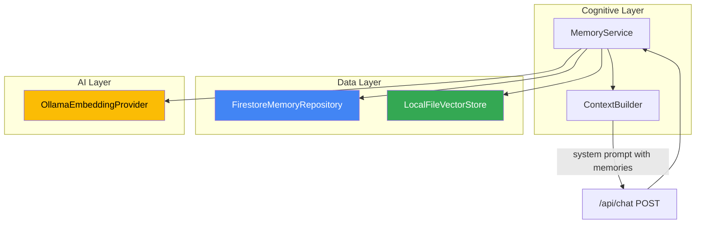

# B.U.T.L.E.R. Alfred — Long-Term Memory Milestone Report

> **Milestone**: Embeddings & Vector Database Infrastructure
> **Status**: ✅ Complete — awaiting review
> **Date**: 2026-09-05

---

## Verification Summary

| Check | Status |
|-------|--------|
| Unit Tests (14 files, 115 tests) | ✅ All passing |
| TypeScript Typecheck (`tsc --noEmit`) | ✅ Clean |
| Production Build (`build:web`) | ✅ Clean |
| `.gitignore` updated (`.data/`) | ✅ |
| `docs/ARCHITECTURE.md` updated | ✅ |
| `.env.example` updated | ✅ |

---

## Architecture

**Invariant**: Firestore = source of truth. Vector DB = rebuildable index.

---

## Files Created (25 new)

### Core Infrastructure
| File | Purpose |
|------|---------|
| [memory.config.ts](file:///home/baris/Belgeler/B.U.T.L.E.R.%20Alfred/src/core/config/memory.config.ts) | Embedding, vector store, retrieval configuration |
| [embedding/types.ts](file:///home/baris/Belgeler/B.U.T.L.E.R.%20Alfred/src/ai/embedding/types.ts) | `IEmbeddingProvider` interface |
| [ollama-embedding-provider.ts](file:///home/baris/Belgeler/B.U.T.L.E.R.%20Alfred/src/ai/embedding/ollama-embedding-provider.ts) | Ollama `/api/embed` + `/api/embeddings` fallback |
| [mock-embedding-provider.ts](file:///home/baris/Belgeler/B.U.T.L.E.R.%20Alfred/src/ai/embedding/mock-embedding-provider.ts) | Deterministic token+3-gram feature hashing |
| [embedding/factory.ts](file:///home/baris/Belgeler/B.U.T.L.E.R.%20Alfred/src/ai/embedding/factory.ts) | Embedding provider factory |
| [embedding/index.ts](file:///home/baris/Belgeler/B.U.T.L.E.R.%20Alfred/src/ai/embedding/index.ts) | Barrel exports |
| [vector/types.ts](file:///home/baris/Belgeler/B.U.T.L.E.R.%20Alfred/src/data/vector/types.ts) | `IVectorStore`, `VectorRecord`, search types |
| [cosine-similarity.ts](file:///home/baris/Belgeler/B.U.T.L.E.R.%20Alfred/src/data/vector/cosine-similarity.ts) | Cosine similarity math utility |
| [in-memory-vector-store.ts](file:///home/baris/Belgeler/B.U.T.L.E.R.%20Alfred/src/data/vector/in-memory-vector-store.ts) | In-memory vector store (test/runtime) |
| [local-file-vector-store.ts](file:///home/baris/Belgeler/B.U.T.L.E.R.%20Alfred/src/data/vector/local-file-vector-store.ts) | Persistent JSON vector store with atomic writes |
| [vector/factory.ts](file:///home/baris/Belgeler/B.U.T.L.E.R.%20Alfred/src/data/vector/factory.ts) | Vector store factory |
| [vector/index.ts](file:///home/baris/Belgeler/B.U.T.L.E.R.%20Alfred/src/data/vector/index.ts) | Barrel exports |
| [memory.types.ts](file:///home/baris/Belgeler/B.U.T.L.E.R.%20Alfred/src/data/firestore/memory.types.ts) | `MemoryVectorDocument`, `MemoryType`, `MemoryStatus` |
| [memory-repository.interface.ts](file:///home/baris/Belgeler/B.U.T.L.E.R.%20Alfred/src/data/firestore/memory-repository.interface.ts) | `IMemoryRepository` interface |
| [in-memory-memory-repository.ts](file:///home/baris/Belgeler/B.U.T.L.E.R.%20Alfred/src/data/firestore/in-memory-memory-repository.ts) | In-memory test repository |
| [firestore-memory-repository.ts](file:///home/baris/Belgeler/B.U.T.L.E.R.%20Alfred/src/data/firestore/firestore-memory-repository.ts) | Firestore `memory_vectors` collection |
| [memory-factory.ts](file:///home/baris/Belgeler/B.U.T.L.E.R.%20Alfred/src/data/firestore/memory-factory.ts) | Memory repository factory |

### Cognitive Memory Service
| File | Purpose |
|------|---------|
| [memory/types.ts](file:///home/baris/Belgeler/B.U.T.L.E.R.%20Alfred/src/alfred/cognitive/memory/types.ts) | `CreateMemoryInput`, `RetrievedMemory`, search options |
| [memory-service.ts](file:///home/baris/Belgeler/B.U.T.L.E.R.%20Alfred/src/alfred/cognitive/memory/memory-service.ts) | Full pipeline: create, search, reindex, retract |
| [memory/index.ts](file:///home/baris/Belgeler/B.U.T.L.E.R.%20Alfred/src/alfred/cognitive/memory/index.ts) | Barrel exports |

### Operational Script
| File | Purpose |
|------|---------|
| [reindex-memories.ts](file:///home/baris/Belgeler/B.U.T.L.E.R.%20Alfred/scripts/reindex-memories.ts) | `npm run memory:reindex` — rebuild vector index from Firestore |

### Tests (4 new test files, 40 tests)
| File | Tests | Status |
|------|-------|--------|
| [vector-store.test.ts](file:///home/baris/Belgeler/B.U.T.L.E.R.%20Alfred/tests/unit/vector-store.test.ts) | 11 | ✅ |
| [embedding-provider.test.ts](file:///home/baris/Belgeler/B.U.T.L.E.R.%20Alfred/tests/unit/embedding-provider.test.ts) | 8 | ✅ |
| [memory-service.test.ts](file:///home/baris/Belgeler/B.U.T.L.E.R.%20Alfred/tests/unit/memory-service.test.ts) | 15 | ✅ |
| [context-builder-memory.test.ts](file:///home/baris/Belgeler/B.U.T.L.E.R.%20Alfred/tests/unit/context-builder-memory.test.ts) | 6 | ✅ |

---

## Files Modified (10)

| File | Change |
|------|--------|
| [.env.example](file:///home/baris/Belgeler/B.U.T.L.E.R.%20Alfred/.env.example) | +12 memory/embedding/vector env vars |
| [.gitignore](file:///home/baris/Belgeler/B.U.T.L.E.R.%20Alfred/.gitignore) | Added `.data/` |
| [route.ts](file:///home/baris/Belgeler/B.U.T.L.E.R.%20Alfred/apps/web/app/api/chat/route.ts) | Memory retrieval step in POST handler (non-blocking) |
| [context-builder.ts](file:///home/baris/Belgeler/B.U.T.L.E.R.%20Alfred/src/alfred/cognitive/context/context-builder.ts) | `formatMemoriesBlock()` + inject into system prompt |
| [config/index.ts](file:///home/baris/Belgeler/B.U.T.L.E.R.%20Alfred/src/core/config/index.ts) | Export memory config |
| [firestore/factory.ts](file:///home/baris/Belgeler/B.U.T.L.E.R.%20Alfred/src/data/firestore/factory.ts) | Export `hasFirestoreCredentials()` |
| [firestore/index.ts](file:///home/baris/Belgeler/B.U.T.L.E.R.%20Alfred/src/data/firestore/index.ts) | Memory exports |
| [src/index.ts](file:///home/baris/Belgeler/B.U.T.L.E.R.%20Alfred/src/index.ts) | Memory/vector/embedding barrel exports |
| [package.json](file:///home/baris/Belgeler/B.U.T.L.E.R.%20Alfred/package.json) | `memory:reindex` script |
| [ARCHITECTURE.md](file:///home/baris/Belgeler/B.U.T.L.E.R.%20Alfred/docs/ARCHITECTURE.md) | Full memory system documentation |

---

## Failure Boundaries

| Failure | Behavior |
|---------|----------|
| Embedding provider down | `createMemory()` throws; no Firestore record created |
| Firestore down | No vector record created; no orphaned vectors |
| Vector store down | `searchMemories()` returns `[]`; chat continues normally |
| Vector index corrupt | `npm run memory:reindex` rebuilds entirely from Firestore |

---

## Known Limitations

> [!NOTE]
> - **Embedding model not pulled**: `nomic-embed-text` is configured but not yet installed on the Ollama server. Until pulled (`ollama pull nomic-embed-text`), the system uses `MockEmbeddingProvider` in tests only.
> - **No autonomous extraction**: This milestone delivers the infrastructure and programmatic `createMemory()` API. Automatic memory extraction from conversations is a future milestone.
> - **Mock similarity ceiling**: `MockEmbeddingProvider` uses feature hashing — cosine similarity between semantically related but differently-worded text peaks around ~0.19. Test thresholds are set accordingly.

---

## Next Steps (Future Milestones)

1. Pull `nomic-embed-text` on Ollama server and test real embeddings end-to-end
2. Implement autonomous memory extraction from conversations
3. Add memory management UI (view, retract, search memories)
4. Implement memory deduplication and supersession logic

> [!IMPORTANT]
> **Working tree is ready for review.** No commits have been made — all changes are staged for your inspection.
